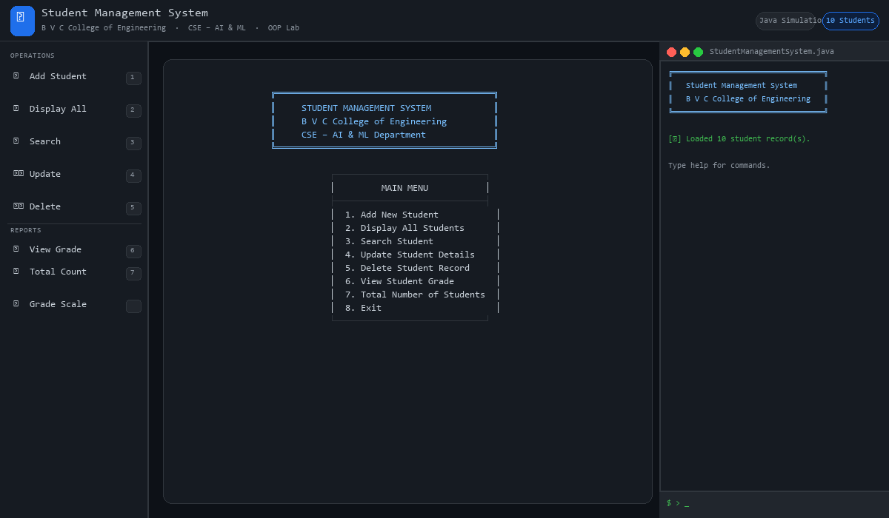
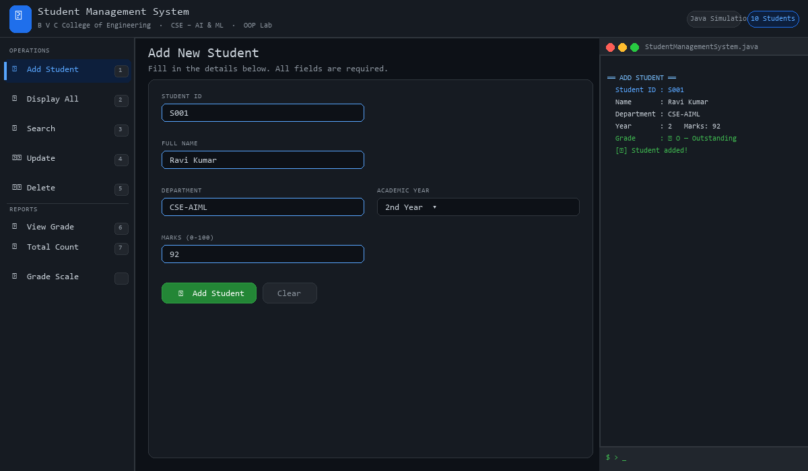
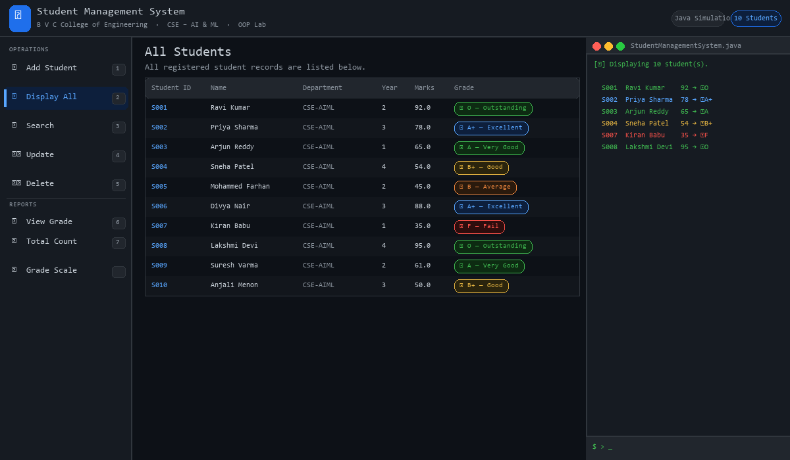
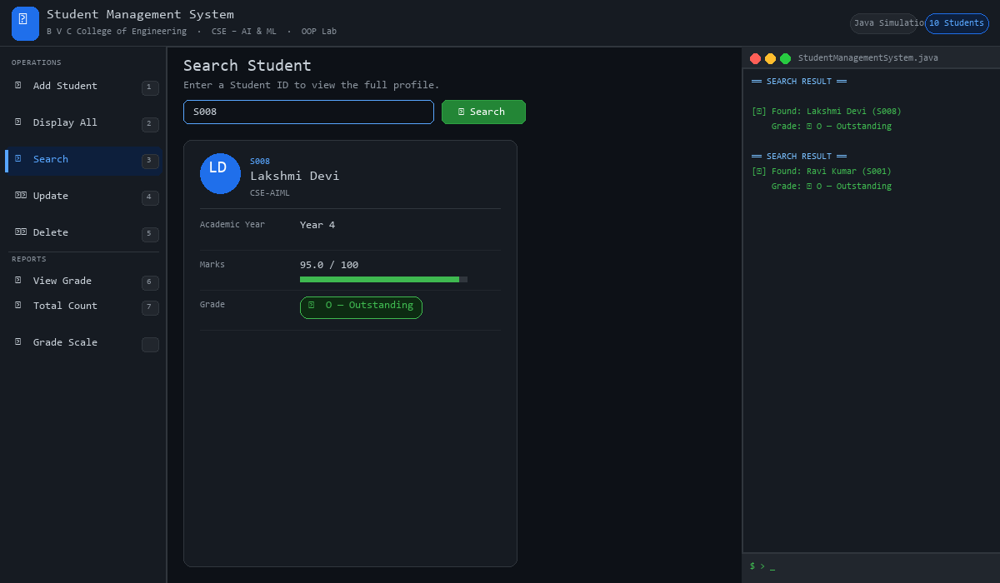
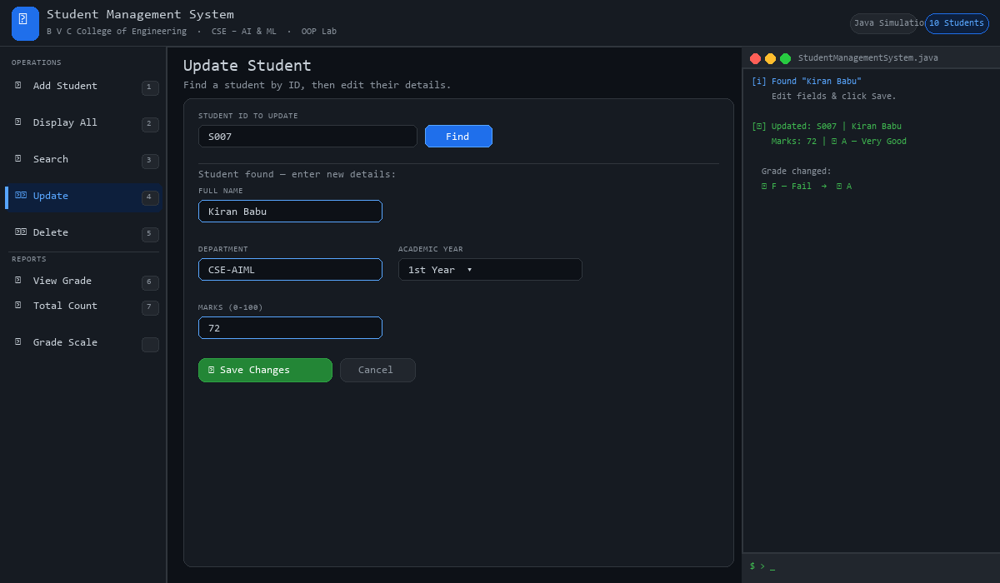
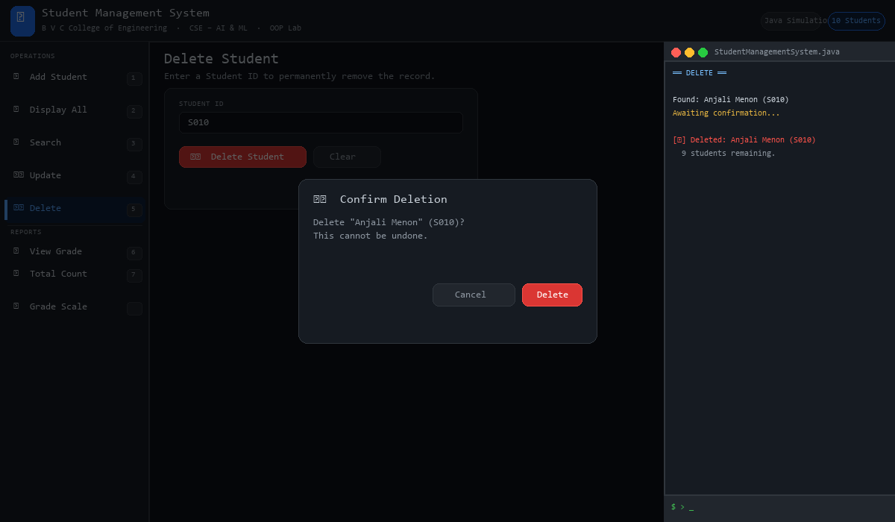
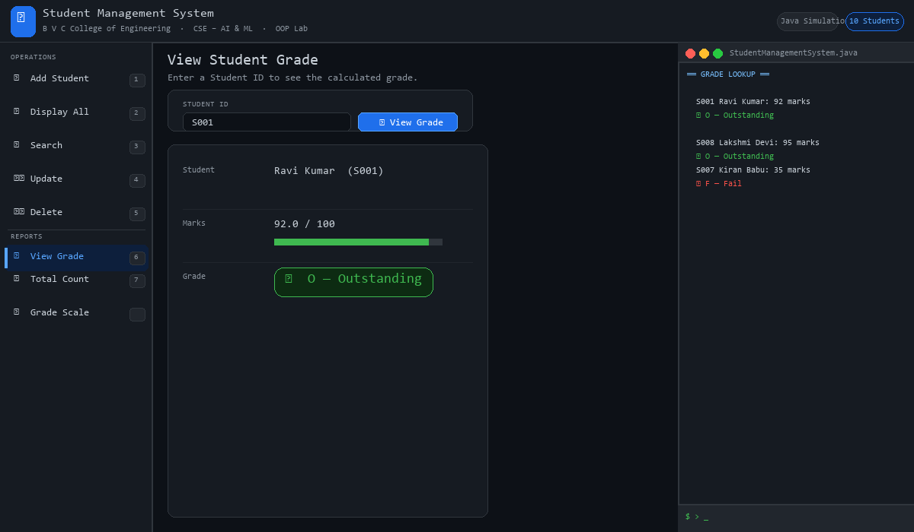
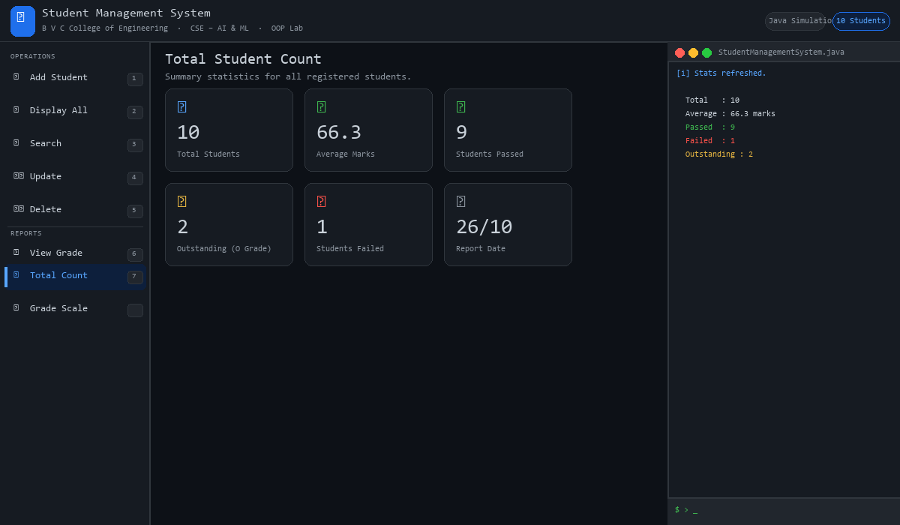
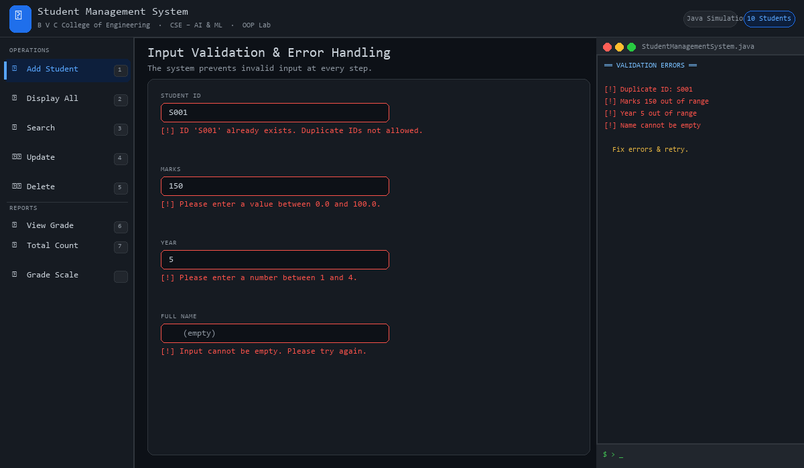
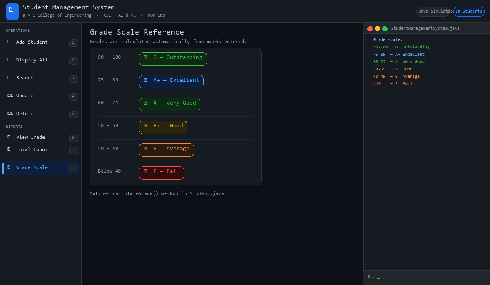

# Student Management System Using Java

> **B V C College of Engineering** &nbsp;|&nbsp; CSE – AI & ML &nbsp;|&nbsp; OOP Laboratory  
> Submission Date: 26 October 2026

---

## 👩‍💻 Created By

| Field | Details |
|---|---|
| **Name** | Sumbul Emam |
| **Roll No.** | 256M1A4297 |
| **Department** | CSE – AI & ML |
| **College** | B V C College of Engineering |
| **Subject** | Object-Oriented Programming Through Java Laboratory |
| **Submission Date** | 26 October 2026 |

---

## Quick Start

```bash
# Step 1 — Navigate to the src folder
cd "Student Management System using java/src"

# Step 2 — Compile all Java files
javac *.java

# Step 3 — Run the application
java StudentManagementSystem
```

---

## Project Structure

```
Student Management System using java/
├── src/
│   ├── StudentOperations.java        ← Interface (Abstraction)
│   ├── Person.java                   ← Abstract base class (Inheritance)
│   ├── Student.java                  ← Student model (all OOP concepts)
│   ├── InputValidator.java           ← Validated input + Exception Handling
│   ├── StudentManager.java           ← Business logic + File Handling
│   └── StudentManagementSystem.java  ← Main class / Entry point
├── docs/
│   ├── CASE_STUDY_REPORT.md
│   ├── SETUP_INSTRUCTIONS.md
│   ├── PPT_CONTENT.md
│   ├── VIVA_QA.md
│   ├── DEMO_SCRIPT.md
│   └── data.md                       ← Sample data & test cases
├── images/                           ← Screenshots of every section
│   ├── 01_welcome.png
│   ├── 02_add_student.png
│   ├── 03_display_all.png
│   ├── 04_search.png
│   ├── 05_update.png
│   ├── 06_delete.png
│   ├── 07_view_grade.png
│   ├── 08_total_count.png
│   ├── 09_validation.png
│   └── 10_grade_scale.png
├── StudentManagementSystem.html      ← Interactive browser simulation
└── README.md                         ← This file
```

---

## OOP Concepts at a Glance

| Concept | Where in Code |
|---|---|
| **Encapsulation** | `Person.java` — all fields `private`, accessed via getters/setters |
| **Inheritance** | `Student extends Person` — reuses id, name, department |
| **Polymorphism** | `getDisplayInfo()` overridden in `Student`; `toString()` overridden |
| **Abstraction** | `StudentOperations` interface + `Person` abstract class |
| **Exception Handling** | `InputValidator.java` + `StudentManager.java` file I/O |
| **File Handling** | `ObjectOutputStream` / `ObjectInputStream` → `students.dat` |

---

## Screenshots

### 1. Welcome Screen

The application launches with a welcome banner and a numbered main menu.  
Student records saved from a previous session are automatically loaded from `students.dat`.



---

### 2. Add New Student

Enter Student ID, Full Name, Department, Year (1–4), and Marks (0–100).  
The system **prevents duplicate IDs** and validates all input before saving.  
On success, the record is immediately written to file.



---

### 3. Display All Students

All registered students are shown in a formatted table with colour-coded grade badges.  
Demonstrates iterating over an `ArrayList<Student>` and calling `toString()` on each object.



---

### 4. Search Student

Search by Student ID to view a full profile card.  
Calls `getDisplayInfo()` — the **overridden abstract method** from `Person` — demonstrating **Polymorphism**.  
A marks progress bar shows the score visually.



---

### 5. Update Student Details

Enter a Student ID to load the existing record into an edit form.  
Change any field (name, department, year, marks) and save.  
The updated record is immediately persisted to `students.dat`.



---

### 6. Delete Student Record

Enter a Student ID to look up the student.  
A confirmation modal appears before deletion — prevents accidental data loss.  
The record is removed from the `ArrayList` and the file is updated.



---

### 7. View Student Grade

Enter any Student ID to see their marks and automatically calculated grade.  
Grade is computed by `calculateGrade()` inside the `Student` class — a behaviour  
encapsulated within the object, not calculated externally.



---

### 8. Total Student Count

Displays a statistics dashboard: total students, average marks, pass/fail counts,  
and outstanding student count. Data is derived in real time from the `ArrayList`.



---

### 9. Input Validation & Error Handling

Every field is validated before data is accepted.  
Invalid marks, duplicate IDs, out-of-range years, and empty names all produce  
clear error messages — no crashes, no corrupt data.  
Handled via `try-catch (NumberFormatException)` in `InputValidator.java`.



---

### 10. Grade Scale Reference

Full grade scale used by `calculateGrade()` in `Student.java`.  
Colour-coded by category for quick reference during viva or demo.



---

## Grade Scale

| Marks Range | Grade |
|---|---|
| 90 – 100 | ⭐ O — Outstanding |
| 75 – 89 | 🔵 A+ — Excellent |
| 60 – 74 | ✅ A — Very Good |
| 50 – 59 | 🟡 B+ — Good |
| 40 – 49 | 🟠 B — Average |
| Below 40 | ❌ F — Fail |

---

## Sample Data (Quick Test)

| Student ID | Name | Department | Year | Marks | Grade |
|---|---|---|---|---|---|
| S001 | Ravi Kumar | CSE-AIML | 2 | 92 | ⭐ O |
| S002 | Priya Sharma | CSE-AIML | 3 | 78 | 🔵 A+ |
| S003 | Arjun Reddy | CSE-AIML | 1 | 65 | ✅ A |
| S004 | Sneha Patel | CSE-AIML | 4 | 54 | 🟡 B+ |
| S005 | Mohammed Farhan | CSE-AIML | 2 | 45 | 🟠 B |
| S006 | Divya Nair | CSE-AIML | 3 | 88 | 🔵 A+ |
| S007 | Kiran Babu | CSE-AIML | 1 | 35 | ❌ F |
| S008 | Lakshmi Devi | CSE-AIML | 4 | 95 | ⭐ O |
| S009 | Suresh Varma | CSE-AIML | 2 | 61 | ✅ A |
| S010 | Anjali Menon | CSE-AIML | 3 | 50 | 🟡 B+ |

Full test scenarios → see [`docs/data.md`](docs/data.md)

---

## Useful Documents

| File | Contents |
|---|---|
| [`docs/SETUP_INSTRUCTIONS.md`](docs/SETUP_INSTRUCTIONS.md) | Compile, run, and test guide |
| [`docs/CASE_STUDY_REPORT.md`](docs/CASE_STUDY_REPORT.md) | Full 17-section college report |
| [`docs/PPT_CONTENT.md`](docs/PPT_CONTENT.md) | 10-slide presentation content |
| [`docs/VIVA_QA.md`](docs/VIVA_QA.md) | 25 viva questions with answers |
| [`docs/DEMO_SCRIPT.md`](docs/DEMO_SCRIPT.md) | 4.5-minute live demo script |
| [`docs/data.md`](docs/data.md) | Sample data + 10 test scenarios |
| [`StudentManagementSystem.html`](StudentManagementSystem.html) | Browser simulation (no Java needed) |

---

---

*Java 17+ required &nbsp;·&nbsp; No external libraries &nbsp;·&nbsp; No database needed*  
*Created by **Sumbul Emam** &nbsp;|&nbsp; Roll No. **256M1A4297** &nbsp;|&nbsp; B V C College of Engineering*
